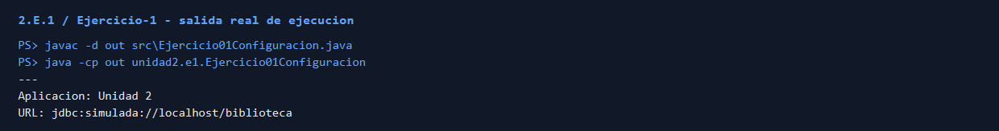

# 2.E.1 - Ejercicio 1: Configuracion inicial

## Objetivo

Centralizar la lectura de propiedades clave-valor usando una instancia Singleton de inicializacion diferida.

## Implementacion

`Ejercicio01Configuracion` carga `src\config.properties` una sola vez. Su constructor es privado y `getInstance()` devuelve siempre la misma referencia.

## Compilar y ejecutar

Desde esta carpeta:

```powershell
javac -d out src\Ejercicio01Configuracion.java
java -cp out unidad2.e1.Ejercicio01Configuracion
```

## Captura de ejecucion


