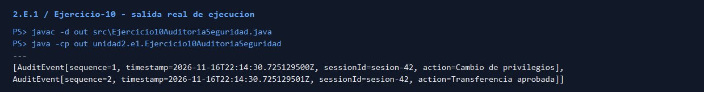

# 2.E.1 - Ejercicio 10: Auditoria de seguridad

## Objetivo

Guardar una traza cronologica de eventos con identificador de sesion y secuencia inalterable desde la interfaz publica.

## Implementacion

`Ejercicio10AuditoriaSeguridad` es un Singleton basado en `enum`, sincroniza el registro y devuelve copias inmutables de la traza.

## Compilar y ejecutar

```powershell
javac -d out src\Ejercicio10AuditoriaSeguridad.java
java -cp out unidad2.e1.Ejercicio10AuditoriaSeguridad
```

## Captura de ejecucion


