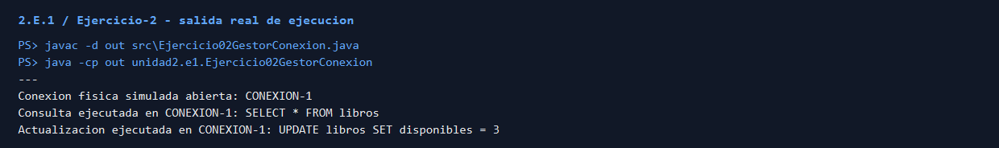

# 2.E.1 - Ejercicio 2: Gestor de conexiones

## Objetivo

Simular la apertura de una conexion fisica unica y ejecutar consultas y actualizaciones a traves del mismo gestor.

## Implementacion

`Ejercicio02GestorConexion` ofrece una instancia Singleton y sincroniza las operaciones de consulta, actualizacion y lectura del estado.

## Compilar y ejecutar

```powershell
javac -d out src\Ejercicio02GestorConexion.java
java -cp out unidad2.e1.Ejercicio02GestorConexion
```

## Captura de ejecucion


