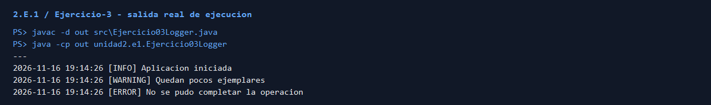

# 2.E.1 - Ejercicio 3: Registro de eventos

## Objetivo

Registrar mensajes INFO, WARNING y ERROR con una marca temporal automatica.

## Implementacion

`Ejercicio03Logger` centraliza la escritura en consola y sincroniza el metodo de registro para ordenar llamadas concurrentes.

## Compilar y ejecutar

```powershell
javac -d out src\Ejercicio03Logger.java
java -cp out unidad2.e1.Ejercicio03Logger
```

## Captura de ejecucion


