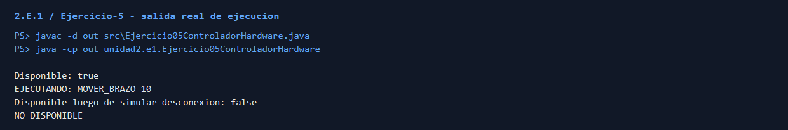

# 2.E.1 - Ejercicio 5: Controlador de hardware

## Objetivo

Simular un controlador unico que valida la disponibilidad del dispositivo, recibe comandos y consulta el estado operativo.

## Implementacion

`Ejercicio05ControladorHardware` proporciona una instancia Singleton y sincroniza el acceso al estado y al envio de comandos.

## Compilar y ejecutar

```powershell
javac -d out src\Ejercicio05ControladorHardware.java
java -cp out unidad2.e1.Ejercicio05ControladorHardware
```

## Captura de ejecucion


