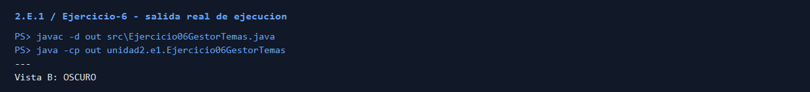

# 2.E.1 - Ejercicio 6: Gestor de temas

## Objetivo

Compartir y actualizar el tema claro u oscuro entre componentes de la interfaz.

## Implementacion

`Ejercicio06GestorTemas` mantiene una instancia Singleton y expone el tema mediante metodos controlados; el estado visible entre hilos es `volatile`.

## Compilar y ejecutar

```powershell
javac -d out src\Ejercicio06GestorTemas.java
java -cp out unidad2.e1.Ejercicio06GestorTemas
```

## Captura de ejecucion


