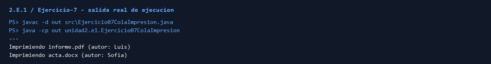

# 2.E.1 - Ejercicio 7: Cola de impresion

## Objetivo

Encolar documentos con autor y procesarlos secuencialmente en orden de llegada.

## Implementacion

`Ejercicio07ColaImpresion` encapsula la cola en un Singleton y sincroniza la incorporacion y el procesamiento de trabajos.

## Compilar y ejecutar

```powershell
javac -d out src\Ejercicio07ColaImpresion.java
java -cp out unidad2.e1.Ejercicio07ColaImpresion
```

## Captura de ejecucion


