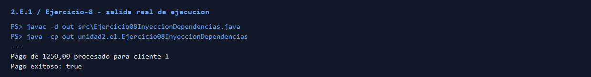

# 2.E.1 - Ejercicio 8: Inyeccion de dependencias

## Objetivo

Desacoplar el servicio consumidor de la pasarela de pago, conservando una unica instancia de esta.

## Implementacion

`GatewayUnico` implementa la interfaz `PaymentGateway`; `CheckoutService` recibe la dependencia por constructor y no realiza llamadas globales.

## Compilar y ejecutar

```powershell
javac -d out src\Ejercicio08InyeccionDependencias.java
java -cp out unidad2.e1.Ejercicio08InyeccionDependencias
```

## Captura de ejecucion


