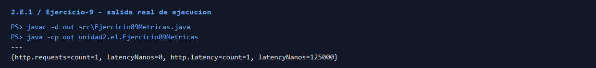

# 2.E.1 - Ejercicio 9: Metricas de rendimiento

## Objetivo

Acumular contadores y latencias de forma concurrente y exportar un resumen de las metricas.

## Implementacion

`Ejercicio09Metricas` usa contadores `LongAdder` y limita a 1000 la cantidad de metricas distintas para controlar el uso de memoria.

## Compilar y ejecutar

```powershell
javac -d out src\Ejercicio09Metricas.java
java -cp out unidad2.e1.Ejercicio09Metricas
```

## Captura de ejecucion


