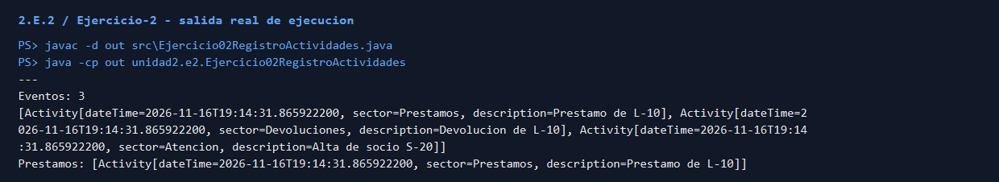

# 2.E.2 - Ejercicio 2: Registro de actividades

## Objetivo

Registrar actividades con fecha, sector y descripcion; consultar el historial, filtrarlo y contar eventos.

## Implementacion

`Ejercicio02RegistroActividades` mantiene una coleccion privada y devuelve listas inmutables desde sus consultas.

## Compilar y ejecutar

```powershell
javac -d out src\Ejercicio02RegistroActividades.java
java -cp out unidad2.e2.Ejercicio02RegistroActividades
```

## Captura de ejecucion


