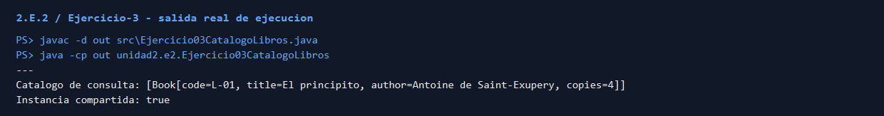

# 2.E.2 - Ejercicio 3: Catalogo de libros

## Objetivo

Compartir un catalogo entre personal y consulta, buscar por titulo o autor y actualizar ejemplares.

## Implementacion

`Ejercicio03CatalogoLibros` valida codigos unicos, evita cantidades negativas y encapsula sus libros en un mapa.

## Compilar y ejecutar

```powershell
javac -d out src\Ejercicio03CatalogoLibros.java
java -cp out unidad2.e2.Ejercicio03CatalogoLibros
```

## Captura de ejecucion


