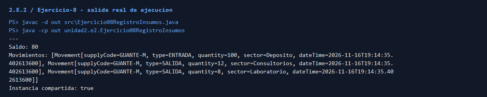

# 2.E.2 - Ejercicio 8: Movimientos de insumos

## Objetivo

Compartir el historial de entradas y salidas de insumos entre deposito, consultorios y laboratorio, y calcular los saldos.

## Implementacion

`Ejercicio08RegistroInsumos` valida cantidades positivas, impide salidas mayores al saldo y no expone una coleccion mutable.

## Compilar y ejecutar

```powershell
javac -d out src\Ejercicio08RegistroInsumos.java
java -cp out unidad2.e2.Ejercicio08RegistroInsumos
```

## Captura de ejecucion


